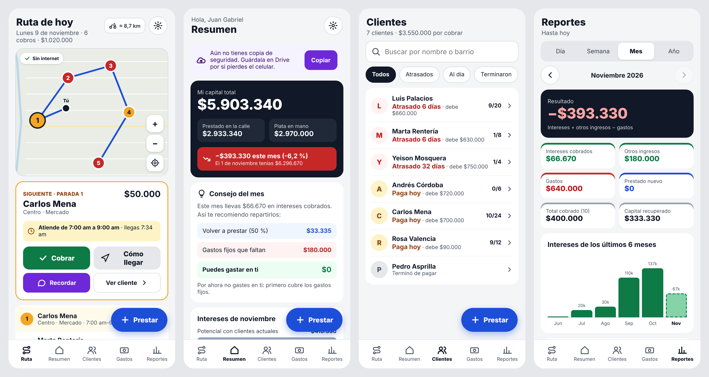

# Tus Finanzas

App de Android para quien presta plata (hecha para Juan Gabriel, en Quibdó).
Clientes, préstamos por cuotas, cobros, ruta del día con minimapa, gastos, reportes y consejos.
**Funciona sin internet.** Los datos viven solo en el celular (más la copia que se guarde en Drive).

- Instalador: [`TusFinanzas.apk`](TusFinanzas.apk) (Android 7 o superior; pensada para Samsung).
- Versión: ver `version.json`.



## Un color = una acción

| Color | Significa |
|---|---|
| Verde | Entra plata: cobrar, ingresos, cuotas pagadas |
| Rojo | Sale plata o hay problema: gastos, atrasados, mora |
| Amarillo | Toca hoy |
| Azul | Crear algo nuevo |
| Morado | Enviar: WhatsApp, recibo, PDF, copia de seguridad |
| Gris | Ver o editar |

## Qué hace

- **Ruta de hoy** (pantalla principal): quién toca cobrar hoy y quién está atrasado, ordenados por el horario de
  atención de cada cliente y por cercanía. Minimapa con los puntos numerados y la ruta.
- **Mapa sin internet**: las calles de Quibdó (OpenStreetMap) vienen dentro de la app (`web/js/mapa-quibdo.js`)
  y la ruta se marca por las calles con A* sin internet. Botón **Google Maps** para la guía calle por calle con datos.
  En Ajustes se pueden actualizar las calles con wifi o apagar el mapa.
- **Préstamos**: monto, interés en **% mensual** (10 % por defecto, se cambia en Ajustes y en cada préstamo)
  o en **pesos**, número de cuotas, frecuencia (diario, semanal, quincenal, mensual,
  trimestral, semestral), mora en % de la cuota y fechas fijas sin domingos ni festivos de Colombia
  (cada fecha se puede cambiar). Opción "Ya venía del cuaderno" para pasar los préstamos que ya existían.
- **Registrar pago**: una o varias cuotas (en orden o las que se elijan) ; recibo como imagen por WhatsApp,
  recordatorio por WhatsApp y deshacer el último pago.
- **Calendario de cuotas** en la ficha: verde a tiempo, naranja pagó otro día, rojo no pagó, naranja pagó tarde, azul le toca hoy.
  Al tocar un día se cambia la fecha de pago, se mueve la fecha de cobro o se desmarca el pago.
- **Resumen**: capital total (prestado en la calle + plata en mano), ganancia frente al 1 del mes,
  consejo de cuánto volver a prestar y cuánto gastar, y gráfica de intereses (potencial, lo que debería llevar y lo real).
- **Cierre del día**: lo que se recogió en la ruta, separado en capital (para volver a prestar) e intereses (ganancia).
- **Reportes** del día, semana, mes y año, y descarga en PDF.
- **Aviso diario** a la hora que se elija: "Hoy tienes 7 cobros por $410.000 · 2 atrasados".
- **Copia de seguridad** a Google Drive y restauración.
- **Clave de 4 números** para abrir la app (se guarda solo una huella; la copia de seguridad no la lleva).
- **Actualizar la app**: revisa `tus-finanzas/version.json` en la rama `main` y descarga el APK nuevo.

## Cómo está hecha

- `web/`: la app (HTML, CSS y JavaScript, sin librerías externas).
  - `js/util.js` plata, fechas y festivos · `js/datos.js` préstamos, capital, reportes y ruta ·
    `js/mapa.js` minimapa · `js/docs.js` recibo PNG y PDF · `js/app.js` pantallas.
- `android/`: el "envase" Android (WebView) con GPS, avisos, compartir archivos y descarga del mapa.
- `build_apk.sh`: arma y firma el APK sin Android Studio (descarga sus herramientas de Maven Central).

### Probar en el computador

```bash
cd tus-finanzas/web && python3 -m http.server 8765
```

Abrir `http://localhost:8765/?hoy=2026-11-09&hora=07:30` (los parámetros `hoy` y `hora` sirven para pruebas).

### Sacar una versión nueva

1. Cambiar `version` y subir `code` en `version.json` (el `code` siempre debe ser mayor que el anterior).
2. Poner la llave de firma en `../.llave/tusfinanzas.p12` y correr:

```bash
TF_STOREPASS="$(cat ../.llave/clave.txt)" ./build_apk.sh
```

3. Instalar el APK nuevo **encima** del anterior: los datos se conservan.

> **La llave de firma (`tusfinanzas.p12` y su clave) NO está en este repositorio.** Guárdala en un lugar seguro.
> Sin ella, una versión nueva no se puede instalar encima y habría que desinstalar (se pierden los datos
> que no estén en una copia de seguridad).

Datos del mapa © colaboradores de OpenStreetMap (licencia ODbL).
